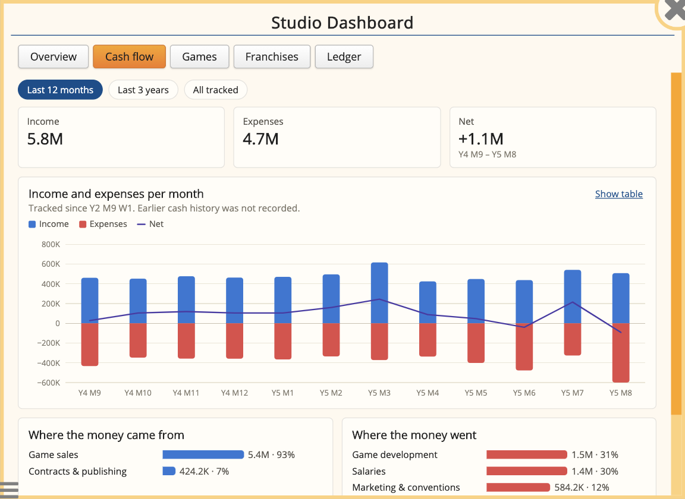
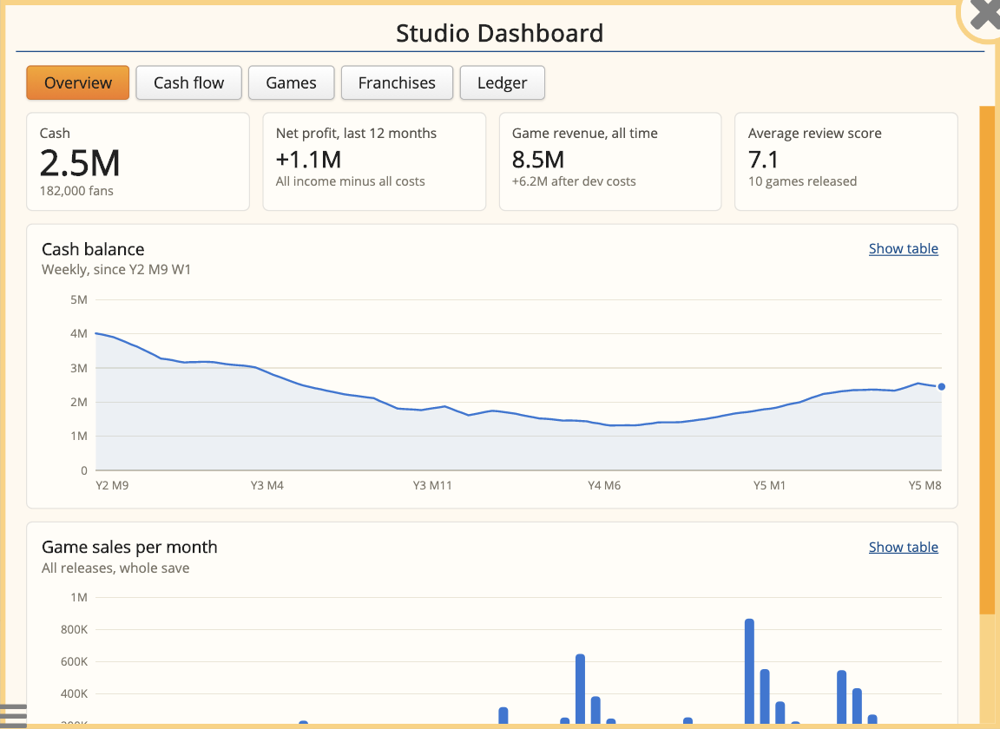
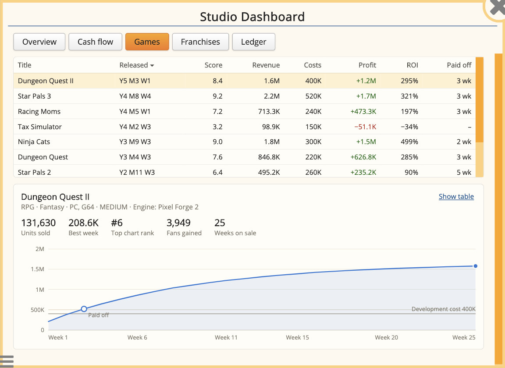
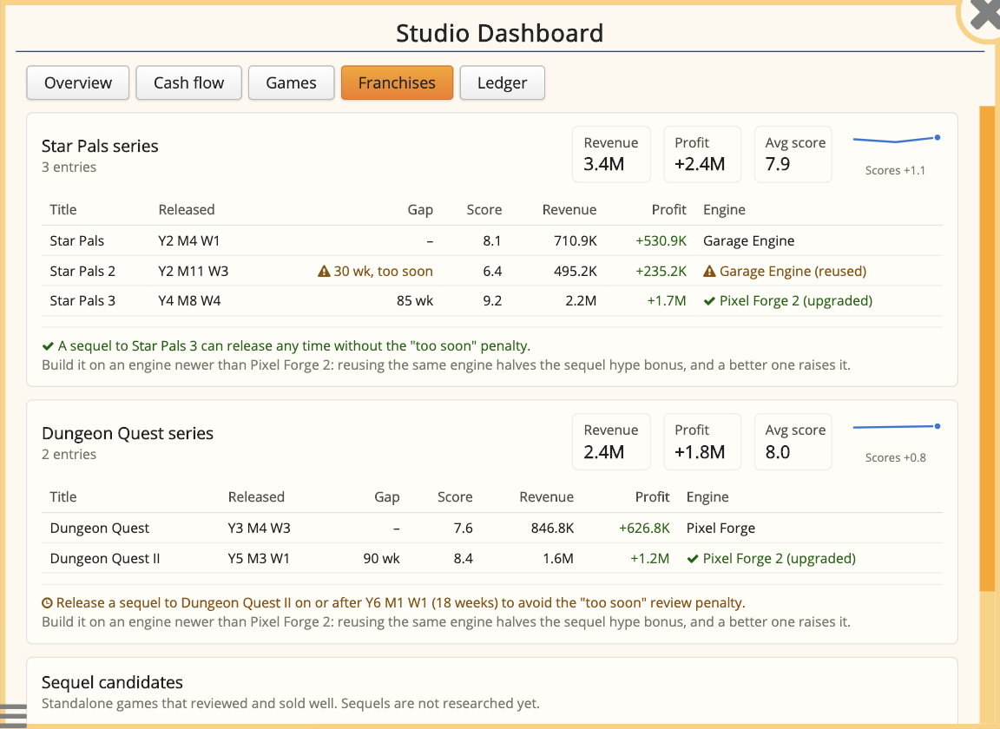

# Studio Dashboard: a Game Dev Tycoon mod

A finance and franchise dashboard for [Game Dev Tycoon](https://www.greenheartgames.com/app/game-dev-tycoon/).
Right-click your office and pick **Studio Dashboard...** to see where your money comes from and goes,
how every game performed, and how your sequels stack up.



## Features

**Overview.** Cash, net profit over the last 12 months, lifetime game revenue and average review
score, a weekly cash balance chart, and game sales per month for the whole save.

**Cash flow.** Monthly income vs expenses with a net line, filterable to the last 12 months, last 3
years or everything tracked, plus a breakdown of where money came from and went: game sales,
contracts, salaries, office upkeep, development, marketing, research, licenses and more.

**Games.** Every release in a sortable table with revenue, costs, profit, ROI and how many weeks it
took to pay for itself. Pick a game to see its cumulative earnings against its development cost.

**Franchises.** Sequels and expansion packs grouped into series with combined revenue, score trends,
release gaps and engine reuse. It flags sequels released within the game's 40-week "too soon" window,
tells you when the next one is safe, and suggests standalone hits worth a sequel.

**Ledger.** The latest individual transactions, filterable by category.

**Franchise gameplay** (on by default). Each series builds a brand from its review scores and grows
tired when entries come too often or disappoint. A new sequel starts with hype from its series'
brand, and its sales rise or fall with brand and fatigue; spin-offs (a new genre or topic) take a
share of the brand with less fatigue. Now and then fans ask for a sequel, celebrate a series' tenth
anniversary or petition for a dormant one, with choices that trade money or promises for brand.
Rules and numbers:
[docs/design/phase-2-franchises.md](docs/design/phase-2-franchises.md).

**Settings.** Each gameplay feature can be switched off per save. Turning on **Developer tools**
adds a Developer tab with cheats for testing: money, fans, research, game speed, finishing the game
in development and made-up release history.

Every chart has a **Show table** toggle, and hovering a chart shows exact values.

| Overview                                  | Games                               | Franchises                                    |
| ----------------------------------------- | ----------------------------------- | --------------------------------------------- |
|  |  |  |

_Screenshots use a demo studio (`scripts/in-game/demo-studio.js`)._

### How it gets its numbers

Per-game numbers, sales history and franchises come from the game's own records, so they cover your
whole save from the moment you install. The game does not keep a history of cash movements, though,
so the cash balance, cash flow and ledger start recording when the mod is first enabled for a save.
That history is stored inside your save file.

## Installing

1. Download this repository and copy the `mod` folder into the game's `mods` folder, renaming it to
   `StudioDashboard`:
   - **Windows:** `C:\Program Files (x86)\Steam\steamapps\common\Game Dev Tycoon\mods\`
   - **Mac:** right-click _Game Dev Tycoon_ in `~/Library/Application Support/Steam/steamapps/common/Game Dev Tycoon/`,
     choose _Show Package Contents_, then open `Contents/Resources/app.nw/mods/`
   - **Linux:** the game's install folder (usually under `~/.steam/steam/steamapps/common/`), then `mods/`
2. Start the game, open **Mods** from the main menu, enable **Studio Dashboard**, and restart.
3. In game, right-click the office floor and choose **Studio Dashboard...**

Loading a save made without the mod shows the game's "mod mismatch" warning once. Choose
**Load Anyway**; the warning goes away after the next save.

Tested on game version 1.8.7 (Steam, macOS). It only reads game data and never changes how the game
plays, so disabling it is safe; any recorded cash history stays in the save, unused.

## Development

Requirements: Node.js 20+, and the game installed through Steam.

```bash
npm install
npm run check      # lint + format check + unit tests
npm run link       # symlink mod/ into the game's mods folder (macOS paths)
```

With the mod linked, edits under `mod/` take effect the next time the game reloads.

### Debugging and automation

The shipped game has no developer tools. Following the
[official guide](https://github.com/greenheartgames/gdt-modAPI/wiki/Debugging-Mods), replace the
game's NW.js runtime with the SDK build of the **same version** (the game currently ships NW.js
0.49.0). On macOS: download `nwjs-sdk-v0.49.0-osx-x64.zip` from dl.nwjs.io, back up
`Game Dev Tycoon.app/Contents/Frameworks` and `Contents/MacOS`, and replace them with the folders from
`nwjs.app/Contents`. Right-click → **Inspect** then opens DevTools. Steam's "Verify integrity of game
files" restores the original.

The scripts drive the running game over the Chrome DevTools Protocol:

| Command                                                        | What it does                                                        |
| -------------------------------------------------------------- | ------------------------------------------------------------------- |
| `npm run game`                                                 | Launch the game with remote debugging (keeps rendering when hidden) |
| `node scripts/reload.mjs`                                      | Reload the game, continue the latest save, dismiss popups, pause    |
| `node scripts/reload.mjs --tab games --shot a.png`             | ...then open a dashboard tab and screenshot it                      |
| `node scripts/cdp.mjs eval "<js>"`                             | Evaluate JavaScript in the game                                     |
| `node scripts/cdp.mjs evalfile scripts/in-game/demo-studio.js` | Load the demo studio (memory only; reload to discard)               |
| `node scripts/screenshots.mjs <dir> [--crop]`                  | Capture every dashboard tab                                         |
| `node scripts/cheat.mjs sandbox`                               | Keep this session's saves (and the release autosave) in memory      |
| `node scripts/cheat.mjs <cheat> [args]`                        | Run a Developer-tab cheat: `cash`, `fans`, `unlock`, `speed`, ...   |
| `node scripts/autoplay.mjs --until release`                    | Play forward to the next release; stops at any decision or error    |

To test gameplay quickly: `sandbox`, build history with `addSeries`, start the game to test, then
`autoplay`. Autoplay only dismisses informational popups and presses Finish/Release Game; it stops
and prints any other decision instead of answering it.

### Layout

| Path            | What it is                                                                                                         |
| --------------- | ------------------------------------------------------------------------------------------------------------------ |
| `mod/`          | The mod itself: this folder is what gets installed or uploaded.                                                    |
| `mod/src/`      | Game-free logic (`classify`, `ledger`, `games`, `franchises`, `charts`) and glue (`hooks`).                        |
| `mod/src/ui/`   | Shared DOM components and the dashboard window.                                                                    |
| `mod/src/tabs/` | One file per dashboard tab.                                                                                        |
| `test/`         | Unit tests (`node:test`) that run mod files in a sandbox, as the game does.                                        |
| `scripts/`      | Dev tooling; `scripts/in-game/` holds snippets evaluated inside the game.                                          |
| `docs/`         | [Architecture](docs/ARCHITECTURE.md), [game internals](docs/GAME-INTERNALS.md) and the [roadmap](docs/ROADMAP.md). |

### Extending

Add a tab by creating `mod/src/tabs/<name>.js`, listing it in `mod/main.js`, and registering it:

```js
((SD) => {
  const render = (body, { company, state, refresh, card }) => {
    body.appendChild(SD.dom.empty(`${company.name} has ${company.staff.length} staff.`));
  };
  SD.tabs = SD.tabs || {};
  SD.tabs.staff = { name: 'Staff', order: 60, render };
})((globalThis.StudioDashboard = globalThis.StudioDashboard || {}));
```

Teach the ledger a new cash label with `SD.classify.addRule((label, ctx) => (label === '...' ? 'category' : null))`.

## Modding Agreement

This mod follows Greenheart Games' Modding Agreement: it is free and non-commercial, contains no game
code or assets, and uses no real-world trademarks. Questions and bug reports:
[GitHub issues](https://github.com/Scc33/game-dev-tycoon-mod/issues) or Sean Coughlin
([github.com/Scc33](https://github.com/Scc33)).

## License

[MIT](LICENSE) for this mod's code. Game Dev Tycoon itself and its assets belong to Greenheart Games,
and use of the mod is also subject to their Modding Agreement.
